# CulturAR

> **Escaneie a obra. Entre nela.**
> Experiência de Realidade Aumentada no navegador do celular para museus: o visitante lê o QR code ao lado de uma pintura, atravessa um portal e passa a estar *dentro* da cena, em 360°, com profundidade calculada por IA.


-green)


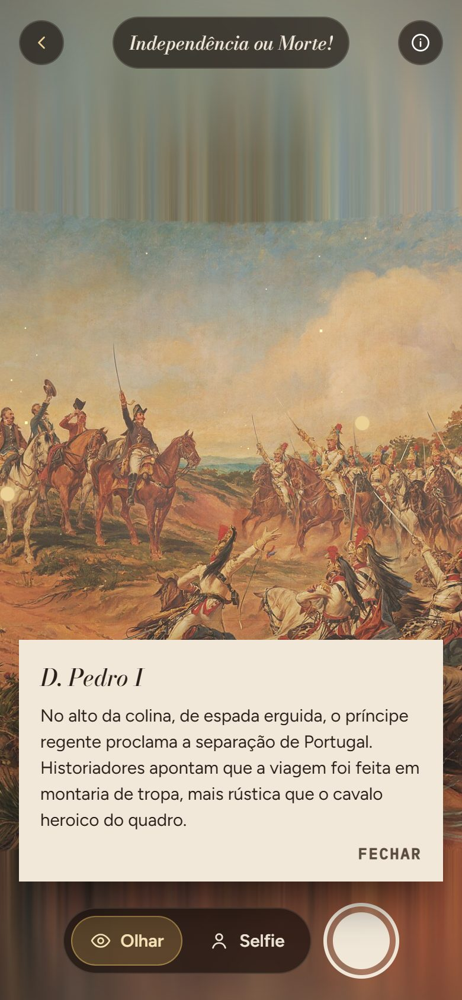

---

## 1. Identificação do Projeto

| Item | Informação |
|---|---|
| **Projeto** | CulturAR |
| **Equipe** | ⚠️ PREENCHER |
| **Curso** | ⚠️ PREENCHER |
| **Disciplina** | UPX — Realidade Aumentada |
| **Professor** | ⚠️ PREENCHER |
| **Semestre** | 2026.2 |
| **Repositório** | https://github.com/Lohries/culturar |

### Integrantes

| Nome | RA | Responsabilidade |
|---|---|---|
| Bruno Messias de Camargo | 235134 | ⚠️ PREENCHER |
| Emanuel Ronaldo Gomes de Souza | 236674 | ⚠️ PREENCHER |
| Felipe de Brito Lima | 236672 | ⚠️ PREENCHER |
| Isadora Gesaro Rezende | 223797 | ⚠️ PREENCHER |
| Luis Henrique Telo Ladeira Mota | 235428 | ⚠️ PREENCHER |
| Matheus de Luzia Souza | 236677 | ⚠️ PREENCHER |

---

## 2. Visão Geral

Pinturas históricas são vistas de longe, atrás de uma faixa de proteção, por poucos segundos. O **CulturAR** transforma esse momento numa experiência: o visitante aponta a câmera do celular para o QR code da placa e o próprio navegador abre a obra. Não há aplicativo para instalar.

Pela câmera traseira, uma **moldura dourada 3D** aparece flutuando na sala do museu, com a pintura dentro. Ao tocar nela, o visitante **atravessa o portal** e a pintura vira um lugar ao redor dele, em 360°: os cavaleiros do primeiro plano ficam perto, o fundo fica longe. Ele olha em volta **girando o celular**, toca nos pontos dourados para ler a história de cada parte da cena e pode tirar uma **selfie dentro da pintura**, com a pessoa recortada do fundo e a etiqueta do museu na foto.

A Realidade Aumentada participa em três momentos:

1. o **QR code** físico ancora a obra real ao conteúdo digital;
2. o **portal** sobrepõe um objeto 3D ao vídeo da câmera, e o giroscópio mantém esse objeto parado no ambiente enquanto o celular se move;
3. a **selfie** mistura a imagem real da pessoa com a cena virtual.

Duas IAs rodam no próprio aparelho: o **Depth Anything V2** calcula a profundidade da pintura e o **MediaPipe Selfie Segmenter** recorta a pessoa.

A obra do protótipo é **Independência ou Morte!** (Pedro Américo, 1888), do acervo do Museu Paulista da USP, em domínio público.

---

## 3. Problema

**Contexto.** Museus de arte guardam obras de grande valor histórico, mas a forma de apresentá-las mudou pouco: a pintura na parede, uma etiqueta com título, autor e data e, às vezes, um audioguia.

**Situação atual.** O visitante passa poucos segundos diante de cada obra. Uma tela como *Independência ou Morte!* tem 4,15 × 7,60 m e dezenas de personagens, mas os detalhes que explicam a cena (quem é quem, o que é idealizado, o que é histórico) não estão na parede. Eles ficam em livros, sites ou com um mediador, que nem sempre está disponível.

**Dificuldade.** Soluções de RA costumam exigir um aplicativo próprio, e pouca gente instala um app para visitar um museu uma vez. Também costumam exigir celulares com ARCore/ARKit, o que exclui parte do público.

**Público afetado.** Visitantes em geral, especialmente estudantes e jovens, que esperam interação digital, e os próprios museus, que precisam de formas baratas de engajar o público sem equipamentos dedicados.

**Impacto.** Visitas rápidas e pouco memoráveis, baixa compreensão do contexto histórico das obras e pouca divulgação espontânea do acervo nas redes sociais.

---

## 4. Objetivos

### 4.1 Objetivo Geral

Desenvolver uma experiência de Realidade Aumentada que roda no navegador do celular, sem instalação, e permite ao visitante de um museu entrar numa pintura a partir do QR code da obra.

### 4.2 Objetivos Técnicos

- Abrir a experiência da obra certa a partir de um QR code lido pela câmera nativa ou por um leitor dentro do app.
- Sobrepor um portal 3D ao vídeo da câmera traseira e mantê-lo estável usando o giroscópio (rastreamento de orientação 3DoF).
- Converter uma pintura 2D numa cena 360° com profundidade, usando um modelo de estimativa de profundidade monocular.
- Executar as IAs no próprio aparelho (WebAssembly), sem servidor.
- Projetar pontos de interesse sobre a cena 3D e exibir textos de mediação.
- Recortar a pessoa da câmera frontal em tempo real e compor a selfie dentro da cena.
- Gerar a foto final com a etiqueta do museu e permitir compartilhar.
- Oferecer à equipe do museu a geração das placas com QR e do mapa de profundidade pré-calculado.
- Validar a experiência com um roteiro de testes no próprio app e com testes automatizados.

---

## 5. Público-Alvo

| Perfil | Contexto | Necessidade | Familiaridade tecnológica |
|---|---|---|---|
| **Visitante** (estudantes, famílias, turistas) | Em pé diante da obra, com o próprio celular, às vezes com internet móvel | Entender a obra de forma rápida e envolvente, sem instalar nada | Básica: sabe ler QR code e tirar foto |
| **Equipe do museu** (educativo, comunicação) | No computador, preparando a exposição | Imprimir as placas e cadastrar novas obras | Intermediária |
| **Testador** (equipe do projeto, voluntários) | Testando em diferentes celulares | Registrar o que funcionou em cada aparelho | Intermediária a alta |

**Limitações consideradas:** celulares modestos (há um modo leve), conexão instável (a imagem da obra e o mapa de profundidade são servidos pelo próprio site), iPhone exigindo permissão explícita de movimento, e pessoas que negam a câmera (o app continua funcionando arrastando a tela).

Materiais complementares, como o roteiro de validação e o relatório de testes, ficam em [`docs/documents/`](docs/documents/).

---

## 6. Funcionalidades

| ID | Funcionalidade | Descrição | Status |
|---|---|---|---|
| RF01 | Abrir obra pelo QR code | A câmera nativa lê a placa e abre `#/obra/<id>` direto no navegador | ✅ |
| RF02 | Leitor de QR no app | Leitor próprio em `#/escanear` (BarcodeDetector ou jsQR) | ✅ |
| RF03 | Etiqueta da obra | Cartão com a pintura emoldurada, título, autor, técnica e acervo | ✅ |
| RF04 | Portal em RA | Moldura dourada 3D sobre o vídeo da câmera traseira | ✅ |
| RF05 | Atravessar o portal | Animação que leva o visitante para dentro da pintura (ou **Pular**) | ✅ |
| RF06 | Cena 360° com profundidade | A pintura vira uma casca 360° deslocada pelo mapa de profundidade | ✅ |
| RF07 | Olhar em volta | Giroscópio controla a câmera virtual; sem giroscópio, arrastar a tela | ✅ |
| RF08 | Pontos de interesse | 4 pontos dourados com textos de mediação sobre a cena | ✅ |
| RF09 | Sobre a obra | Painel com o resumo histórico da obra | ✅ |
| RF10 | Selfie na cena | Câmera frontal com recorte da pessoa (MediaPipe) dentro da pintura | ✅ |
| RF11 | Foto com etiqueta | Foto composta com a faixa da etiqueta do museu; compartilhar ou salvar | ✅ |
| RF12 | Placas com QR | `#/painel` gera e imprime as placas com o endereço público | ✅ |
| RF13 | Mapa de profundidade pré-calculado | `#/painel` gera o PNG para o visitante não baixar a IA | ✅ |
| RF14 | Roteiro de validação | `#/validacao`: checklist com diagnóstico automático do aparelho | ✅ |
| RF15 | Exportar testes em CSV | Compartilhar ou copiar os testes salvos no aparelho | ✅ |
| RF16 | Modo leve | Malha 3D reduzida para celulares fracos; hoje só ativada pelo console | 🚧 |
| RF17 | Áudio ambiente | Som de cavalos, vento e o grito, por obra | ⬜ |
| RF18 | Andar dentro da cena | Rastreamento de posição (6DoF) com WebXR `immersive-ar` | ⬜ |
| RF19 | Panorama 360° completo | Completar o que fica atrás do visitante com IA (outpainting) | ⬜ |
| RF20 | Mais obras no acervo | Cadastrar outras pinturas em `src/obras.js` | ⬜ |
| RF21 | Resultados centralizados | Enviar os testes de validação para um servidor, sem troca de arquivos | ⬜ |

**Legenda:** ✅ Implementado · 🚧 Em desenvolvimento · ⬜ Planejado · ❌ Cancelado

---

## 7. Requisitos Não Funcionais

| ID | Categoria | Requisito |
|---|---|---|
| RNF01 | Distribuição | Funcionar no navegador, sem instalar aplicativo |
| RNF02 | Segurança | Ser servido por HTTPS (exigência do navegador para câmera e giroscópio) |
| RNF03 | Compatibilidade | Safari no iOS 16.4 ou mais novo (usa `OffscreenCanvas`) e Chrome no Android, com WebGL 2 |
| RNF04 | Privacidade | Imagens da câmera processadas só no aparelho; nada é enviado a servidor |
| RNF05 | Desempenho | Botão "Entrar no quadro" ativo em poucos segundos quando a imagem e o mapa de profundidade estão no site |
| RNF06 | Conectividade | Com os arquivos da obra no site, a cena funciona sem baixar IA; a selfie baixa cerca de 250 KB do MediaPipe |
| RNF07 | Usabilidade | Fluxo de no máximo dois toques do QR code até estar dentro da pintura |
| RNF08 | Robustez | Sem câmera ou sem giroscópio, o app continua utilizável (portal na parede, arrastar para olhar) |
| RNF09 | Hospedagem | Site estático, publicável em qualquer serviço (Netlify, Vercel, GitHub Pages) sem configurar servidor |
| RNF10 | Direitos | Usar só obras em domínio público ou com autorização do acervo |

---

## 8. Tecnologias Utilizadas

| Tecnologia | Versão | Utilização |
|---|---|---|
| JavaScript (ES2022) + JSX | — | Linguagem da aplicação |
| Node.js | 22.15.0 (mínimo 18 para o app, 22 para os scripts de teste) | Ambiente de desenvolvimento e build |
| npm | 11.4.0 | Gerenciador de pacotes |
| Vite | 5.4.21 | Servidor de desenvolvimento e build |
| React / React DOM | 18.3.1 | Interface e páginas |
| three.js | 0.186.1 | Cena 3D em WebGL: casca 360°, moldura, portal com stencil, shaders |
| WebGL 2 / GLSL | — | Renderização e deslocamento da malha pela profundidade |
| Transformers.js (`@huggingface/transformers`) | 4.3.1 | Executa o modelo de profundidade no navegador |
| ONNX Runtime Web | 1.31.0-dev (embutido no Transformers.js) | Execução do modelo em WebAssembly |
| Depth Anything V2 Small (`onnx-community/depth-anything-v2-small`, q8) | V2, quantizado 8 bits | Estimativa de profundidade monocular da pintura |
| MediaPipe Tasks Vision | 1.1.0 | Segmentação da pessoa na selfie |
| MediaPipe Selfie Segmenter | float16 (`latest`) | Modelo de recorte da pessoa |
| jsQR | 1.4.0 | Leitura de QR code quando o navegador não tem `BarcodeDetector` |
| qrcode | 1.5.4 | Geração dos QR codes das placas |
| @vitejs/plugin-react | 4.7.0 | Suporte a React no Vite |
| @vitejs/plugin-basic-ssl | 1.2.0 | HTTPS local para testar no celular |
| APIs Web | — | `getUserMedia` (câmera), `DeviceOrientationEvent` (giroscópio), `BarcodeDetector`, Web Share, IndexedDB, Web Workers |
| Google Chrome | 156.0.8078.48 | Testes automatizados (headless) |
| Mermaid | 10.9.1 | Geração dos diagramas |
| Git / GitHub | 2.49.0 / — | Controle de versão e hospedagem do repositório |

---

## 9. Hardware Utilizado

| Equipamento | Modelo | Característica relevante | Utilização |
|---|---|---|---|
| Notebook | Acer Nitro ANV15-51 | Intel Core i7-13620H, 16 GB RAM, NVIDIA GeForce RTX 4050 Laptop, Windows 11 Pro | Desenvolvimento, build e testes automatizados |
| Smartphone | ⚠️ PREENCHER (modelo real usado) | ⚠️ sistema e versão | Testes da experiência no celular |
| Smartphone | ⚠️ PREENCHER | ⚠️ | ⚠️ |

> Só entram nesta tabela aparelhos realmente usados pela equipe.

---

## 10. Arquitetura do Sistema

O CulturAR é uma **aplicação web estática** (SPA). Não há servidor de aplicação nem banco de dados: tudo roda no navegador do visitante. Os serviços externos só são usados quando falta um arquivo local, por exemplo na primeira visita sem o mapa de profundidade pré-calculado.

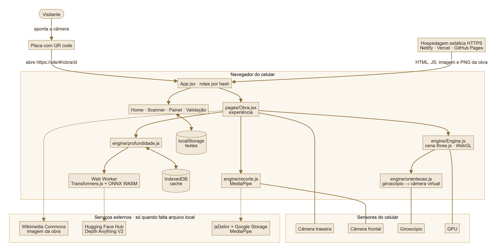

### Fluxo resumido

```text
Visitante
   ↓  lê o QR code da placa
Navegador (HTTPS)  →  App.jsx (rotas por hash)
   ↓
pages/Obra.jsx  ──→  engine/profundidade.js → Web Worker → Depth Anything V2 (WASM)
   ↓            ──→  engine/recorte.js → MediaPipe Selfie Segmenter
engine/Engine.js (three.js / WebGL)
   ↓
engine/orientacao.js  ←  giroscópio (DeviceOrientation)
   ↓
Câmera traseira (vídeo ao fundo) + canvas WebGL transparente por cima
```

---

## 11. Funcionamento da Realidade Aumentada

### 11.1 Técnica utilizada

O CulturAR combina três abordagens:

| Abordagem | Onde | Tecnologia |
|---|---|---|
| **QR Code (marcador de ativação)** | A placa ao lado da obra abre a experiência daquela obra | Câmera nativa do celular, `BarcodeDetector` ou jsQR |
| **RA de sobreposição com rastreamento de orientação (3DoF)** | O portal: objeto 3D sobre o vídeo da câmera, fixo no ambiente enquanto o celular gira | `getUserMedia` + three.js + `DeviceOrientationEvent` |
| **Composição com segmentação de pessoa** | A selfie: a pessoa real recortada dentro da cena virtual | MediaPipe Selfie Segmenter |

O rastreamento é **3DoF**: o app sabe para onde o celular aponta (rotação), mas não onde ele está (posição). Por isso não é usado ARCore/ARKit nem detecção de planos. Essa escolha permite rodar em qualquer navegador sem instalar nada, ao custo de não reconhecer quando o visitante anda (ver [Limitações](#24-limitações-conhecidas)).

### 11.2 Fluxo técnico

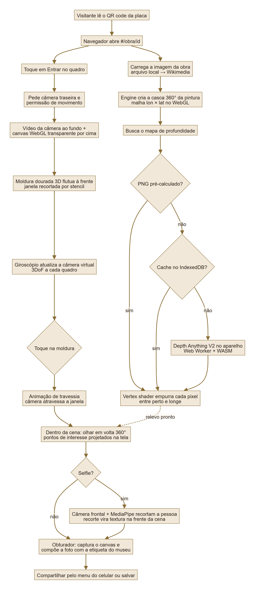

1. **Ativação.** O QR code contém `https://<site>/#/obra/<id>`. O navegador abre a página da obra e [`App.jsx`](src/App.jsx) escolhe a obra em [`obras.js`](src/obras.js).
2. **Imagem.** [`imagem.js`](src/engine/imagem.js) carrega a pintura de `public/obras/<id>.jpg`; se o arquivo não existir, usa o Wikimedia Commons.
3. **Cena 360°.** [`Engine.js`](src/engine/Engine.js) cria uma malha de 900 × 360 vértices em coordenadas de longitude e latitude, cobrindo a esfera ao redor do visitante. A pintura ocupa `campo` graus à frente (90° no protótipo). O resto do círculo é a pintura espelhada, que encaixa sem emenda.
4. **Profundidade.** [`profundidade.js`](src/engine/profundidade.js) busca o mapa em tons de cinza nesta ordem: PNG pré-calculado, depois cache no IndexedDB, depois IA no aparelho. No **vertex shader**, cada vértice é empurrado para uma distância entre `perto` (3,2 m) e `longe` (42 m) conforme o cinza do mapa: claro fica perto, escuro fica longe.
5. **Portal.** Ao tocar em **Entrar no quadro**, o app pede a câmera traseira e a permissão de movimento. O vídeo fica atrás e o canvas WebGL transparente por cima. A moldura dourada 3D é desenhada e marca sua janela no **stencil buffer**. Num segundo passe, a cena é desenhada só dentro dessa janela, com uma projeção que encaixa a pintura inteira na moldura.
6. **Rastreamento.** A cada quadro, [`orientacao.js`](src/engine/orientacao.js) converte os ângulos `alpha`, `beta` e `gamma` do giroscópio num quatérnion e o aplica à câmera virtual. Assim a moldura fica parada no ambiente real enquanto o celular gira. No primeiro quadro, o mundo é alinhado para a obra ficar à frente do visitante.
7. **Travessia.** Ao tocar na moldura, a câmera virtual avança através da janela em 1,8 s. Quando ela passa, o stencil é desligado e a câmera real também. O visitante agora está no centro da cena.
8. **Pontos de interesse.** Cada ponto tem coordenadas (u, v) na pintura. `pontoNaCena` converte essas coordenadas em posições 3D já deslocadas pela profundidade, e `projetar` as leva para a tela a cada quadro.
9. **Selfie.** [`recorte.js`](src/engine/recorte.js) abre a câmera frontal e roda o MediaPipe em cada quadro de vídeo. A máscara de confiança vira um canal alfa, a pessoa recortada vira uma textura na frente da cena e a câmera virtual passa a olhar para trás do visitante.
10. **Foto.** O canvas WebGL é capturado (`preserveDrawingBuffer`) e composto com a faixa da etiqueta do museu. A foto é compartilhada pelo menu do celular (Web Share) ou salva.

### 11.3 Como a profundidade é obtida

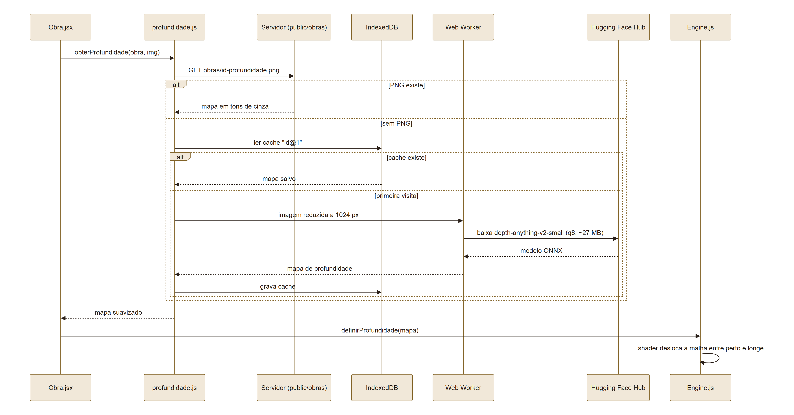

| Mapa de profundidade gerado pela IA (claro = perto) | Resultado dentro da cena |
|---|---|
| 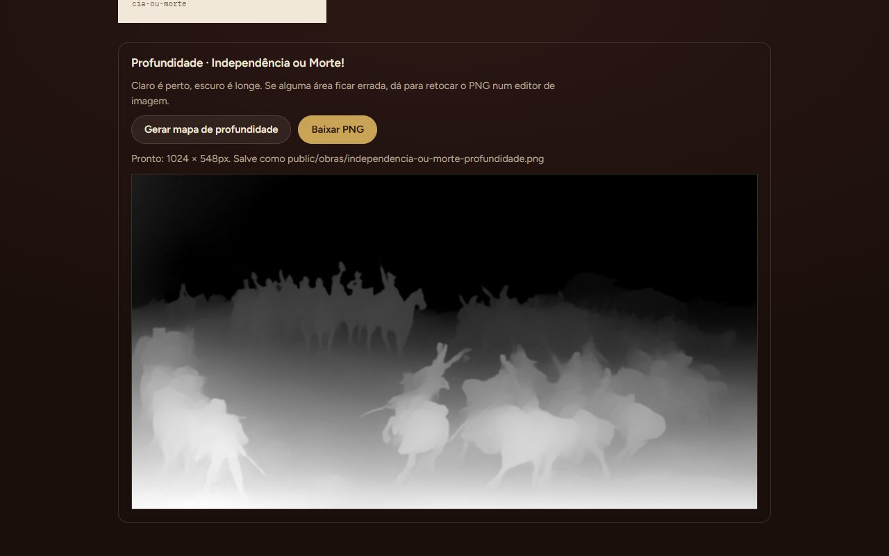 | 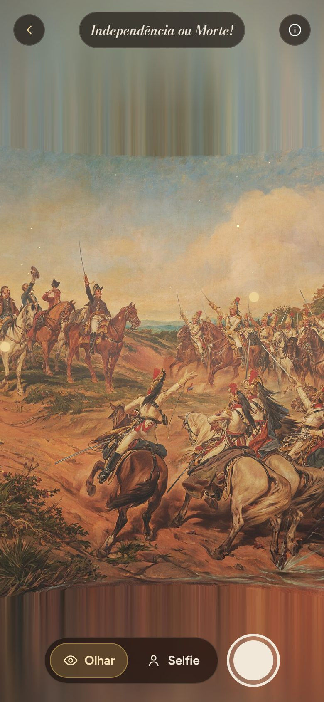 |

O modelo calcula a profundidade **relativa** (o que está mais perto do que o quê), não distâncias em metros. As distâncias reais da cena vêm dos parâmetros `ambiente` de cada obra em `obras.js`.

### 11.4 Elementos virtuais

- moldura dourada 3D com material metálico (portal);
- pintura transformada em cena 3D com relevo;
- poeira flutuando na cena;
- pontos de interesse dourados e painéis de texto;
- recorte da pessoa tingido com o tom da pintura (selfie);
- etiqueta do museu na foto final.

---

## 12. Estrutura do Projeto

```text
culturar/
│
├── src/
│   ├── main.jsx                 ponto de entrada do React
│   ├── App.jsx                  rotas por hash
│   ├── obras.js                 acervo: textos, imagens, parâmetros da cena e pontos
│   ├── validacao.js             passos do roteiro, diagnóstico automático e CSV
│   ├── validacao-exemplos.json  12 testes fictícios (só no modo de desenvolvimento)
│   ├── icones.jsx               ícones SVG
│   ├── styles.css               estilos
│   ├── pages/
│   │   ├── Home.jsx             acervo
│   │   ├── Scanner.jsx          leitor de QR
│   │   ├── Obra.jsx             a experiência (entrada → portal → cena → selfie → foto)
│   │   ├── Painel.jsx           placas com QR e gerador de profundidade
│   │   └── Validacao.jsx        roteiro de validação
│   └── engine/
│       ├── Engine.js            cena 3D (three.js)
│       ├── orientacao.js        giroscópio → câmera virtual
│       ├── profundidade.js      mapa de profundidade (arquivo → cache → IA)
│       ├── profundidade.worker.js  Depth Anything V2 num Web Worker
│       ├── recorte.js           recorte da pessoa (MediaPipe)
│       └── imagem.js            carregamento da imagem da obra
│
├── public/obras/                imagem da obra e mapa de profundidade pré-calculado
├── scripts/
│   ├── teste-e2e.mjs            teste automatizado ponta a ponta + screenshots
│   └── diagramas.mjs            gera os PNG dos diagramas a partir do Mermaid
│
├── docs/
│   ├── diagrams/                diagramas (.mmd = fonte, .png = imagem)
│   ├── images/                  screenshots e foto gerada pelo app
│   └── documents/               roteiro de validação e relatório de testes
│
├── index.html
├── vite.config.js
├── package.json / package-lock.json
├── CHANGELOG.md
├── .gitignore
└── README.md
```

### Pastas principais

| Pasta | Finalidade |
|---|---|
| `src/engine` | Núcleo da RA: cena 3D, rastreamento de orientação, profundidade e recorte |
| `src/pages` | Telas da aplicação |
| `public/obras` | Arquivos de cada obra (`<id>.jpg` e `<id>-profundidade.png`), servidos pelo próprio site |
| `scripts` | Automação de testes e de documentação |
| `docs/diagrams` | Diagramas técnicos |
| `docs/images` | Screenshots e evidências |
| `docs/documents` | Documentos complementares |

---

## 13. Principais Scripts

| Arquivo | Responsabilidade |
|---|---|
| [`src/engine/Engine.js`](src/engine/Engine.js) | Cria a cena three.js: malha 360° com shader de profundidade, moldura com stencil, animação de travessia, plano da selfie, projeção dos pontos e captura da foto |
| [`src/engine/orientacao.js`](src/engine/orientacao.js) | Lê o giroscópio, pede a permissão no iPhone e converte a orientação em quatérnion da câmera; sem giroscópio, usa o arrasto |
| [`src/engine/profundidade.js`](src/engine/profundidade.js) | Decide de onde vem o mapa de profundidade, suaviza o resultado e grava o cache no IndexedDB |
| [`src/engine/profundidade.worker.js`](src/engine/profundidade.worker.js) | Roda o Depth Anything V2 fora da thread principal, com progresso do download |
| [`src/engine/recorte.js`](src/engine/recorte.js) | Abre a câmera frontal e gera a cada quadro um canvas com a pessoa e fundo transparente |
| [`src/pages/Obra.jsx`](src/pages/Obra.jsx) | Orquestra a experiência: fases, permissões, modos Olhar/Selfie, pontos, foto e compartilhamento |
| [`src/pages/Painel.jsx`](src/pages/Painel.jsx) | Gera as placas com QR e o PNG de profundidade |
| [`src/pages/Validacao.jsx`](src/pages/Validacao.jsx) + [`src/validacao.js`](src/validacao.js) | Roteiro de validação com diagnóstico automático e exportação em CSV |
| [`src/obras.js`](src/obras.js) | Dados de cada obra: textos, imagens, parâmetros da cena e pontos de interesse |
| [`scripts/teste-e2e.mjs`](scripts/teste-e2e.mjs) | Teste automatizado do fluxo completo no Chrome, com câmera simulada |

---

## 14. Dependências

Declaradas em [`package.json`](package.json) e instaladas com `npm install`:

```text
@huggingface/transformers 4.3.1     (inclui onnxruntime-web)
@mediapipe/tasks-vision   1.1.0
three                     0.186.1
react / react-dom         18.3.1
jsqr                      1.4.0
qrcode                    1.5.4
vite                      5.4.21    (desenvolvimento)
@vitejs/plugin-react      4.7.0     (desenvolvimento)
@vitejs/plugin-basic-ssl  1.2.0     (desenvolvimento)
```

Recursos baixados pelo navegador em tempo de execução:

| Recurso | Origem | Quando |
|---|---|---|
| Modelo Depth Anything V2 Small (~27 MB) | [Hugging Face — onnx-community/depth-anything-v2-small](https://huggingface.co/onnx-community/depth-anything-v2-small) | Só se não houver o PNG pré-calculado nem cache |
| MediaPipe WASM | [jsDelivr — @mediapipe/tasks-vision@1.1.0](https://cdn.jsdelivr.net/npm/@mediapipe/tasks-vision@1.1.0/wasm) | Ao tocar em **Selfie** |
| Modelo Selfie Segmenter (~250 KB) | [Google Storage — mediapipe-models](https://storage.googleapis.com/mediapipe-models/image_segmenter/selfie_segmenter/float16/latest/selfie_segmenter.tflite) | Ao tocar em **Selfie** |
| Imagem da obra | [Wikimedia Commons](https://commons.wikimedia.org/wiki/File:Pedro_Am%C3%A9rico_-_Independ%C3%AAncia_ou_Morte_-_Google_Art_Project.jpg) | Só se faltar `public/obras/<id>.jpg` |

---

## 15. Configuração do Ambiente

### Pré-requisitos

- Windows 10/11, macOS ou Linux;
- [Node.js 22 LTS](https://nodejs.org/) (inclui o npm). O app funciona com Node 18 ou mais novo; os scripts de teste precisam do 22;
- [Git](https://git-scm.com/);
- Google Chrome (para os testes automatizados);
- um celular com câmera e giroscópio, na mesma rede Wi-Fi do computador, para testar a RA.

### Procedimento

1. Instale o Node.js 22 LTS e o Git.
2. Confira as versões:
   ```bash
   node --version    # v22.x
   git --version
   ```
3. Clone o repositório e instale as dependências:
   ```bash
   git clone https://github.com/Lohries/culturar.git
   cd culturar
   npm install
   ```
4. Não há chaves de API nem variáveis de ambiente para configurar.

---

## 16. Como Executar

### No computador

```bash
npm run dev
```

Abra **http://localhost:5173**. Sem giroscópio, arraste com o mouse para olhar em volta; a webcam faz a selfie.

### No celular (mesma rede Wi-Fi)

Câmera e giroscópio só funcionam em HTTPS. O comando abaixo sobe o servidor com um certificado de teste:

```bash
npm run celular
```

1. O terminal mostra um endereço como `https://192.168.x.x:5173`. Abra-o no celular.
2. O navegador avisa que a conexão não é particular, porque o certificado é autoassinado. Toque em **Avançado → Continuar**.

### Publicar (para o QR code funcionar em qualquer lugar)

```bash
npm run build      # gera a pasta dist/
npm run preview    # confere o build localmente
```

Publique a pasta `dist/` num serviço com HTTPS:

- **Netlify Drop:** arraste a pasta `dist` em app.netlify.com/drop.
- **Vercel:** `npx vercel` na pasta do projeto.
- **GitHub Pages:** envie o conteúdo de `dist/` para a branch `gh-pages`. No plano gratuito, exige repositório público.

Depois, abra `https://SEU-SITE/#/painel`, confirme o endereço público e clique em **Imprimir placas**.

### Testes automatizados

Com o servidor rodando (`npm run dev`), em outro terminal:

```bash
npm run teste:e2e
```

O script abre o Chrome em modo invisível, simula um celular com câmera e percorre o fluxo inteiro. Ele imprime PASSOU/FALHOU por passo, atualiza as screenshots em `docs/images/` e grava o relatório em `docs/documents/resultado-teste-e2e.json`. Se o Chrome estiver em outro lugar, defina `CHROME_PATH`.

---

## 17. Como Utilizar a Aplicação

| 1. Escanear | 2. Entrada | 3. Portal |
|---|---|---|
| 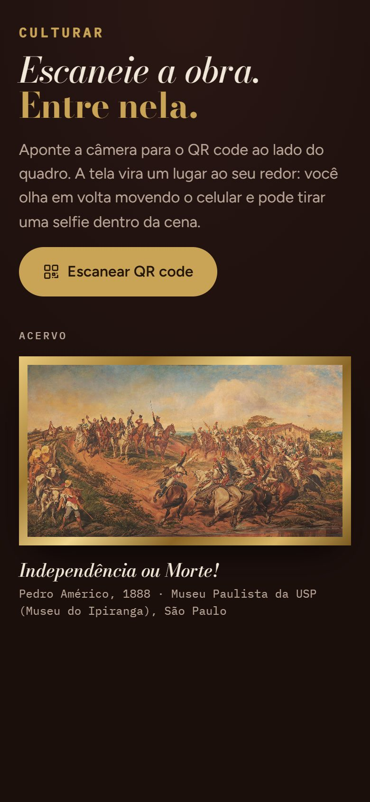 | 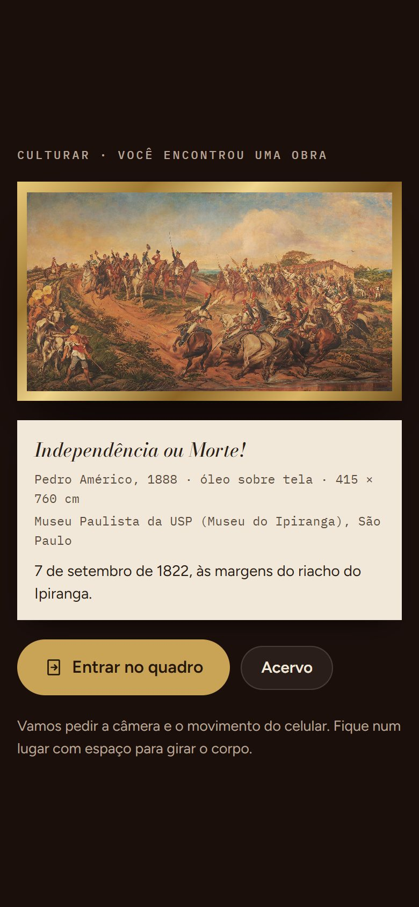 | 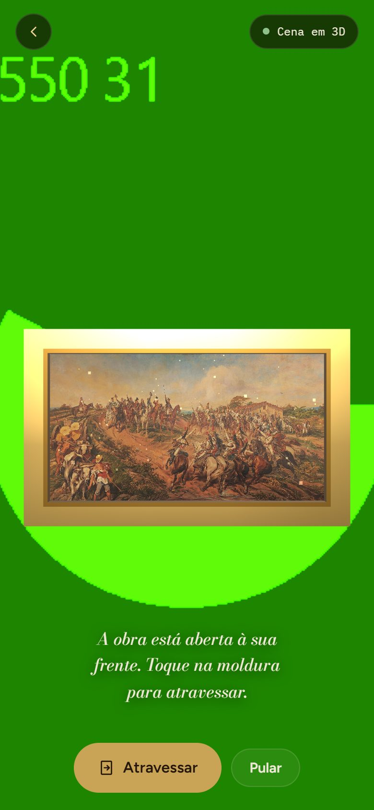 |
| Aponte a câmera do celular para o QR code da placa. Também dá para usar **Escanear QR code** no app. | A etiqueta da obra aparece. Toque em **Entrar no quadro** e autorize a câmera e o movimento. | A moldura dourada aparece na sala. Toque nela ou em **Atravessar**. |

| 4. Dentro da cena | 5. Pontos de interesse | 6. Foto |
|---|---|---|
|  |  | 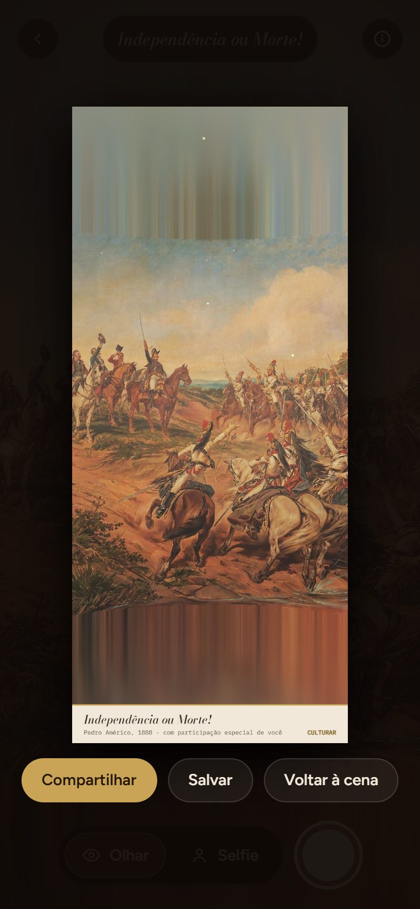 |
| Gire o corpo com o celular para olhar em volta. | Toque num ponto dourado para ler sobre aquela parte. O ícone ⓘ abre o resumo da obra. | Toque em **Selfie**, vire-se para a câmera e aperte o botão redondo. Depois, **Compartilhar** ou **Salvar**. |

Fique num lugar com espaço para girar o corpo. Sem permissão de movimento, arraste a tela para olhar em volta.

---

## 18. Fluxo de Funcionamento

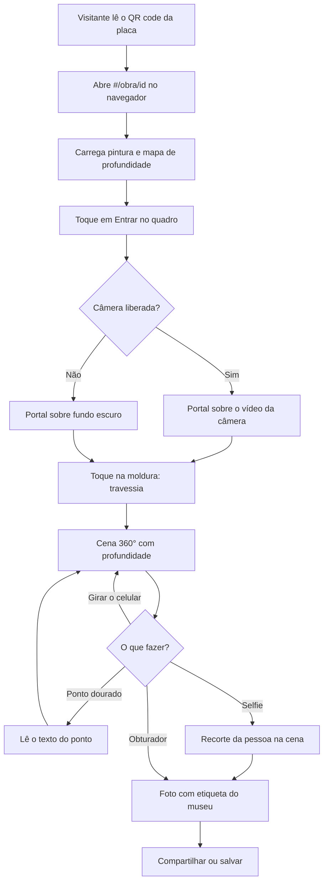

---

## 19. Caso de Uso

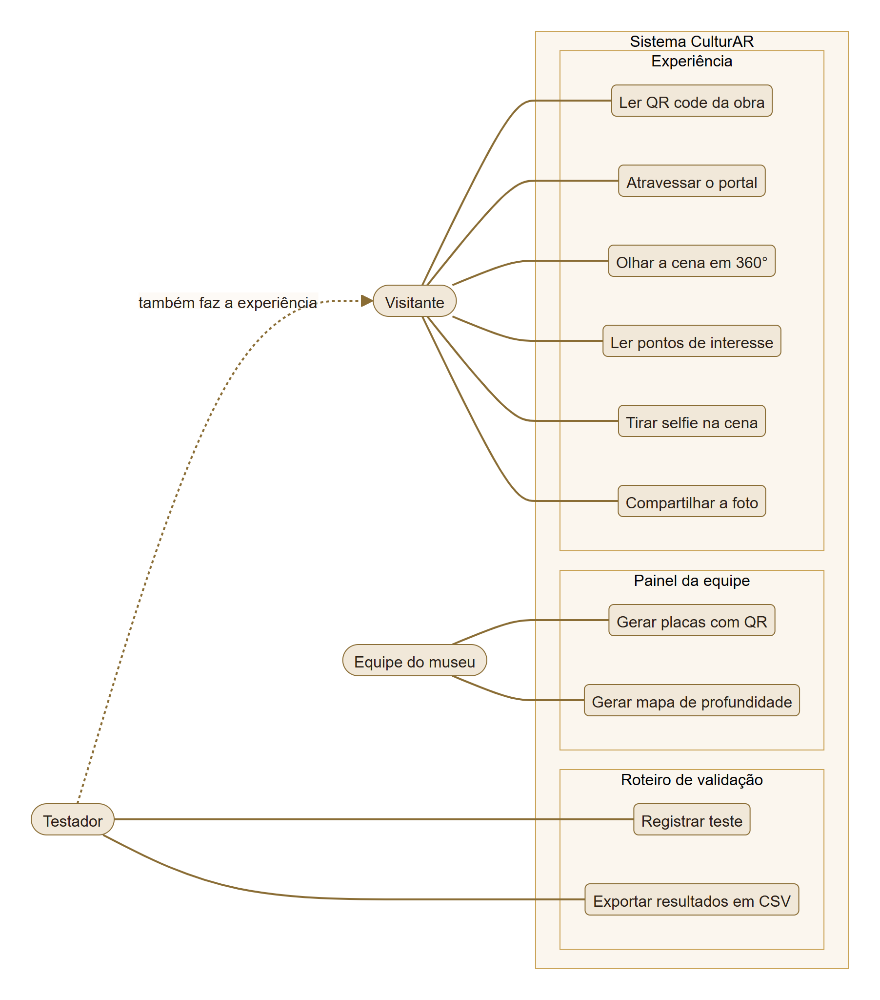

---

## 20. Fluxo de Navegação

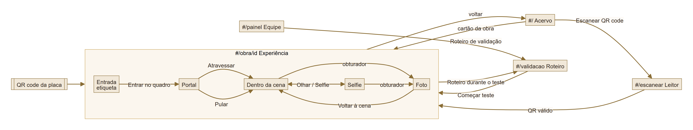

| Rota | Tela |
|---|---|
| `#/` | Acervo, com o botão de escanear |
| `#/escanear` | Leitor de QR code dentro do app |
| `#/obra/<id>` | A experiência da obra (é para cá que a placa aponta) |
| `#/painel` | Painel da equipe: placas com QR e gerador de profundidade |
| `#/validacao` | Roteiro de validação para os testadores |

As rotas usam `#`, então funcionam em qualquer hospedagem estática sem configurar redirecionamentos.

---

## 21. Interface

| Tela | Finalidade | Principais elementos | Ação do usuário |
|---|---|---|---|
|  **Acervo** | Porta de entrada sem QR | Título, botão **Escanear QR code**, cartões das obras | Escanear ou escolher uma obra |
| 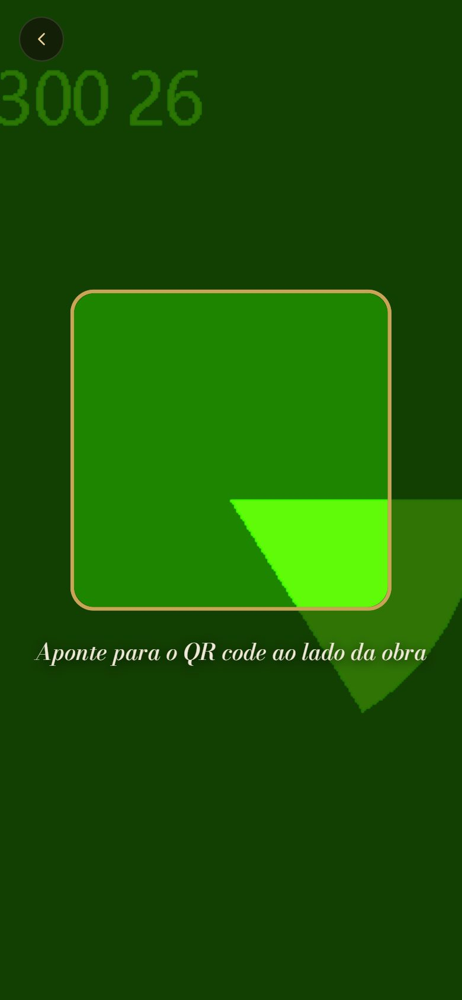 **Leitor de QR** | Ler a placa dentro do app | Vídeo da câmera, mira dourada, mensagem de status | Apontar para a placa |
|  **Entrada** | Apresentar a obra | Pintura emoldurada, etiqueta do museu, **Entrar no quadro** | Iniciar a experiência |
|  **Portal** | Mostrar a obra flutuando na sala | Vídeo da câmera, moldura 3D, status da profundidade, **Atravessar** e **Pular** | Atravessar a moldura |
|  **Dentro da cena** | Explorar a pintura em 360° | Cena 3D, pontos dourados, botões **Olhar** e **Selfie**, obturador | Girar o celular, tocar nos pontos |
|  **Foto** | Levar a experiência para casa | Foto com a etiqueta, **Compartilhar**, **Salvar** e **Voltar à cena** | Compartilhar a foto |
| 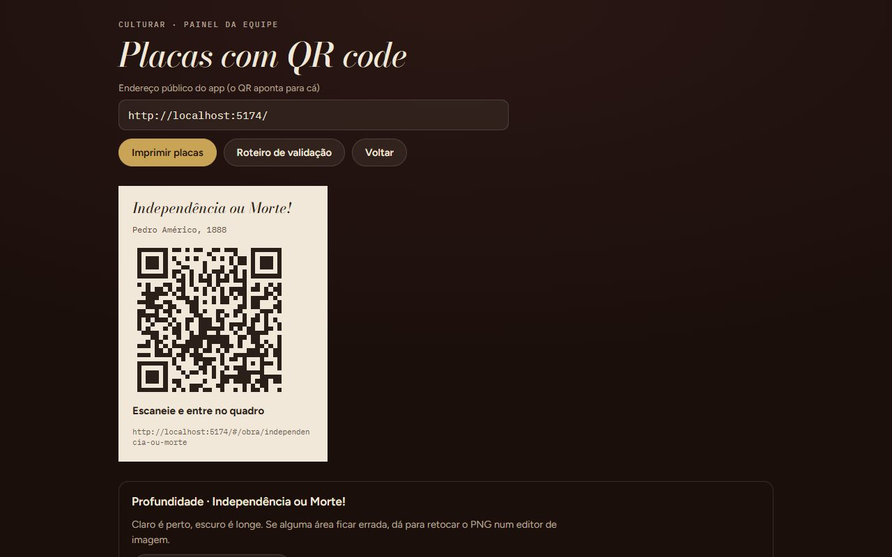 **Painel** | Preparar a exposição | Endereço público, placa com QR, **Imprimir placas**, gerador de profundidade | Imprimir as placas |
| 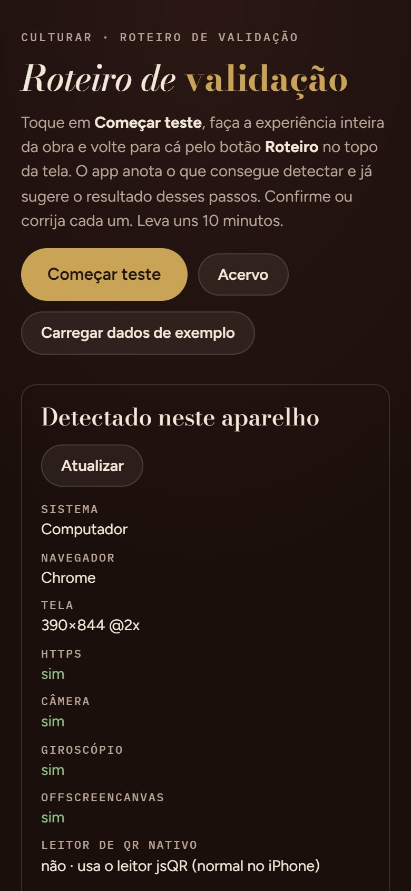 **Validação** | Registrar testes por aparelho | Recursos detectados, anotações automáticas, checklist por etapa | Marcar cada passo e salvar |

No portal, o fundo verde com números é a câmera **simulada** do Chrome usada nos testes automatizados. Num celular, ali aparece o ambiente real.

---

## 22. Testes Técnicos

### 22.1 Teste automatizado ponta a ponta

Realizado em **31/10/2026** com `npm run teste:e2e`, no notebook de desenvolvimento, com Chrome 156 em modo headless, tela de celular emulada (390 × 844) e **câmera simulada**. Relatório completo: [`docs/documents/resultado-teste-e2e.json`](docs/documents/resultado-teste-e2e.json).

| Teste | Procedimento | Resultado esperado | Resultado obtido | Status |
|---|---|---|---|---|
| Inicialização | Abrir `#/` | Acervo aparece | Acervo renderizado | ✅ |
| Placa com QR | Abrir `#/painel` | QR aponta para `#/obra/independencia-ou-morte` | QR gerado com o endereço certo | ✅ |
| IA de profundidade | **Gerar mapa de profundidade** no painel | PNG do mapa | 1024 × 548 px em 43 s, incluindo o download do modelo | ✅ |
| Carregar obra | Abrir `#/obra/independencia-ou-morte` | **Entrar no quadro** fica ativo | Botão ativo | ✅ |
| Câmera traseira | Tocar em **Entrar no quadro** | Vídeo da câmera atrás do portal | Vídeo exibido | ✅ |
| Portal | Idem | Moldura 3D aparece | Moldura exibida | ✅ |
| Profundidade | Aguardar o indicador | "Cena em 3D" | "Cena em 3D", com o PNG pré-calculado | ✅ |
| Travessia | Tocar em **Atravessar** | Entrar na cena | Cena 360° exibida | ✅ |
| Pontos de interesse | Olhar para a frente | 4 pontos visíveis | 4 de 4 visíveis | ✅ |
| Olhar em volta | Arrastar a tela | A vista gira e os pontos acompanham | Vista girou | ✅ |
| Texto do ponto | Tocar num ponto | Painel com o texto | "D. Pedro I" exibido | ✅ |
| Sobre a obra | Tocar em ⓘ | Resumo da obra | Exibido | ✅ |
| Selfie | Tocar em **Selfie** | Câmera frontal + MediaPipe ativos | Modo selfie ativado | ✅ |
| Foto | Tocar no obturador | Foto com etiqueta | Foto 780 × 1798 com etiqueta | ✅ |
| Leitor de QR | Abrir `#/escanear` | Câmera do leitor abre | Vídeo ativo | ✅ |
| QR de obra inexistente | Abrir `#/obra/nao-existe` | Aviso "não está no acervo" | Aviso exibido | ✅ |
| Roteiro de validação | Abrir `#/validacao` após o fluxo | Anotações automáticas e passos pré-marcados | 9 anotações, 8 passos pré-marcados | ✅ |
| Erros de execução | Console do navegador durante todo o fluxo | Nenhum erro | Nenhum erro | ✅ |
| Build de produção | `npm run build` | Build sem erros | Build concluído; JS principal com 301 KB gzip | ✅ |

### 22.2 O que o teste automatizado não cobre

| Teste | Por quê | Status |
|---|---|---|
| Giroscópio real | Não existe no navegador headless; foi testado o arrasto, que usa a mesma câmera virtual | ⬜ |
| Qualidade do recorte da selfie | A câmera simulada não mostra uma pessoa | ⬜ |
| Leitura de uma placa impressa | Exige câmera real | ⬜ |
| Desempenho e aquecimento em celular | Exige aparelho real | ⬜ |

Esses itens são verificados com o **roteiro de validação** do app (`#/validacao`), feito em celulares reais. O roteiro completo está em [`docs/documents/roteiro-de-validacao.md`](docs/documents/roteiro-de-validacao.md).

---

## 23. Dispositivos Testados

| Dispositivo | Sistema | Versão | Navegador | Resultado |
|---|---|---|---|---|
| Acer Nitro ANV15-51 (notebook) | Windows 11 Pro | 10.0.26200 | Chrome 156 (headless, câmera simulada) | Compatível: fluxo completo, 18/18 passos (sem giroscópio) |
| ⚠️ PREENCHER (celular real) | ⚠️ | ⚠️ | ⚠️ | ⚠️ |

> Só entram aqui aparelhos realmente testados. Os 12 testes de `src/validacao-exemplos.json` são **fictícios** e servem só para demonstrar o roteiro; eles não contam como testes.

---

## 24. Limitações Conhecidas

- **Só rotação, não posição (3DoF).** O celular percebe quando o visitante gira, mas não quando anda. Andar dentro da cena exigiria WebXR `immersive-ar` (só no Chrome Android).
- **Atrás do visitante aparece a pintura espelhada.** Ela encaixa sem emenda, mas não é uma cena nova.
- **Céu e chão esticados.** Acima e abaixo da pintura, as bordas são estendidas e desfocadas. Em celular em pé, isso aparece como faixas verticais (visível nas screenshots).
- **Profundidade relativa.** A IA não sabe distâncias reais; `perto` e `longe` são ajustados à mão por obra. Erros do modelo podem ser retocados no PNG.
- **iOS anterior a 16.4** não tem `OffscreenCanvas`: a cena entra em modo simples, sem profundidade.
- **iPhone pede permissão de movimento uma vez.** Se o visitante negar, só dá para pedir de novo recarregando a página.
- **A selfie depende de internet e de um celular razoável.** O MediaPipe é baixado de CDN e roda a cada quadro.
- **Firefox e alguns navegadores não têm o menu de compartilhar.** Nesses casos, a foto é baixada.
- **Uma obra no acervo.** As posições dos pontos de interesse são aproximadas.
- **Resultados de validação ficam no aparelho.** Não há servidor; cada testador exporta um CSV.
- **Ainda não testado em celulares reais pela documentação.** Os testes registrados até aqui são automatizados (ver seção 22).

---

## 25. Evidências de Funcionamento

**Foto gerada pelo próprio app** (botão obturador, modo Olhar), com a etiqueta do museu:

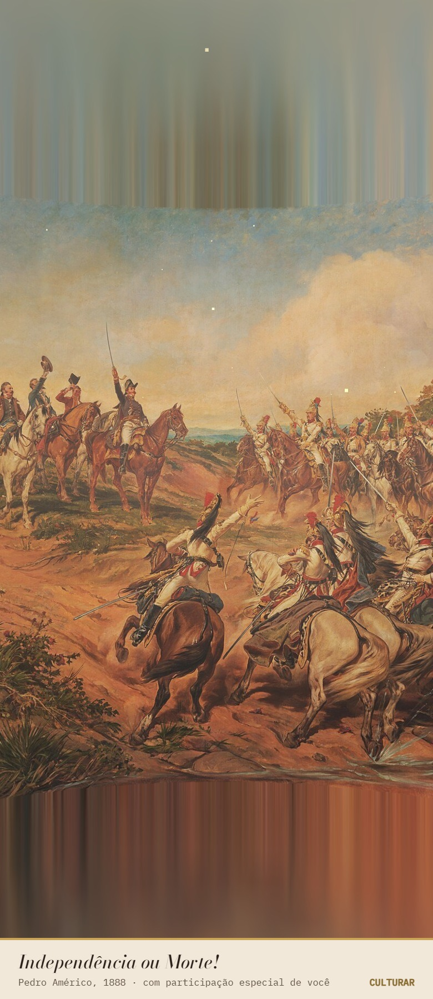

**Olhar em volta:** a mesma cena antes e depois de girar a vista.

| Olhando para a frente | Depois de girar para a direita |
|---|---|
|  | 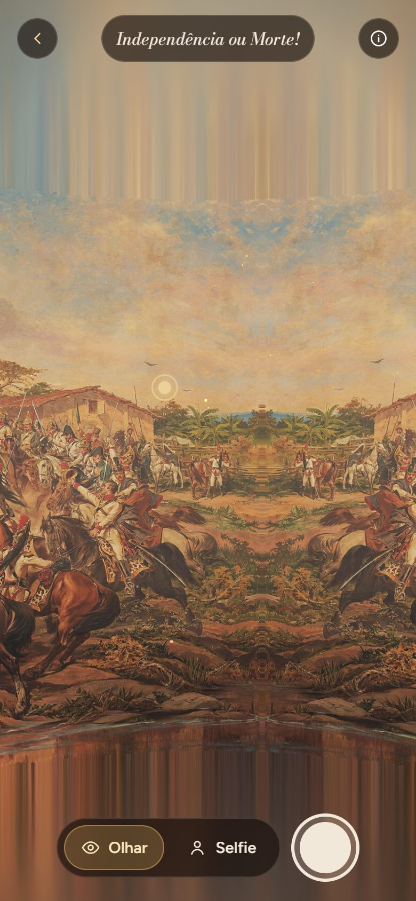 |

**Teste automatizado:** 18 de 18 passos aprovados, sem erros no console ([relatório](docs/documents/resultado-teste-e2e.json)).

**Vídeo da experiência em celular:** ⚠️ PREENCHER com o link do vídeo gravado pela equipe.

---

## 26. Repositórios e Recursos

| Recurso | Link |
|---|---|
| Código-fonte | https://github.com/Lohries/culturar |
| Obra (imagem em domínio público) | [Wikimedia Commons — Independência ou Morte!](https://commons.wikimedia.org/wiki/File:Pedro_Am%C3%A9rico_-_Independ%C3%AAncia_ou_Morte_-_Google_Art_Project.jpg) |
| Modelo de profundidade | [Depth Anything V2 Small (ONNX)](https://huggingface.co/onnx-community/depth-anything-v2-small) |
| Modelo de recorte | [MediaPipe Image Segmenter](https://ai.google.dev/edge/mediapipe/solutions/vision/image_segmenter) |
| Roteiro de validação | [`docs/documents/roteiro-de-validacao.md`](docs/documents/roteiro-de-validacao.md) |
| Histórico de versões | [`CHANGELOG.md`](CHANGELOG.md) |

---

## 27. Cronograma Técnico

| Atividade | Responsável | Status |
|---|---|---|
| Pesquisa da obra e textos dos pontos de interesse | ⚠️ PREENCHER | ✅ |
| Configuração do projeto (Vite + React) | ⚠️ PREENCHER | ✅ |
| Cena 360° e shader de profundidade (three.js) | ⚠️ PREENCHER | ✅ |
| Integração do Depth Anything V2 | ⚠️ PREENCHER | ✅ |
| Portal com stencil e rastreamento por giroscópio | ⚠️ PREENCHER | ✅ |
| Selfie com MediaPipe e composição da foto | ⚠️ PREENCHER | ✅ |
| Painel da equipe (placas e profundidade) | ⚠️ PREENCHER | ✅ |
| Roteiro de validação no app | ⚠️ PREENCHER | ✅ |
| Testes automatizados e documentação técnica | ⚠️ PREENCHER | ✅ |
| Testes em celulares reais | Equipe | 🚧 |
| Publicação em hospedagem HTTPS | Equipe | ⬜ |
| Áudio ambiente e novas obras | Equipe | ⬜ |

---

## 28. Controle de Versão

O projeto usa commits no padrão *Conventional Commits*, tags por versão e o [`CHANGELOG.md`](CHANGELOG.md).

```text
feat: adiciona dados de exemplo ao roteiro de validação
fix: corrige URLs de reserva da imagem no Wikimedia Commons
feat: inclui a imagem da obra e o mapa de profundidade pré-calculado
test: adiciona teste automatizado ponta a ponta
docs: adiciona diagramas, screenshots e documentos
docs: reescreve o README no modelo da disciplina
```

| Tag | Conteúdo |
|---|---|
| `v0.1.0` | Protótipo inicial: portal, cena 360°, selfie, painel e roteiro de validação |
| `v0.2.0` | Arquivos da obra no site, correção das URLs, testes automatizados e documentação técnica |

---

## 29. Problemas Encontrados e Soluções

### Problema 1 — Primeira visita lenta

**Problema:** sem mapa pré-calculado, a primeira visita de cada celular fica parada em "Baixando IA de profundidade". No teste automatizado, só o download e o cálculo levaram 43 s num notebook com boa conexão.
**Causa:** o modelo Depth Anything V2 tem cerca de 27 MB e ainda precisa rodar no aparelho.
**Solução:** o painel da equipe gera o mapa uma única vez e ele é salvo em `public/obras/<id>-profundidade.png`. O app usa esse arquivo primeiro, depois o cache do IndexedDB, e só em último caso a IA. Com o PNG no site, o visitante não baixa IA nenhuma para a cena.

### Problema 2 — URLs de reserva da imagem quebradas

**Problema:** sem o arquivo local, a imagem da obra demorava mais para carregar.
**Causa:** o Wikimedia Commons passou a gerar miniaturas só em larguras padronizadas, e a de 2560 px respondia **erro 400**. Além disso, um dos arquivos listados (`Independência ou Morte (Pedro Américo).jpg`) não existe no Commons e respondia **404**.
**Solução:** a lista ficou com 1920 px e 3840 px, que funcionam, e a imagem da obra passou a ser servida pelo próprio site, em `public/obras/`.

### Problema 3 — Câmera e giroscópio não funcionavam no celular

**Problema:** aberto pelo IP da rede em HTTP, o app não consegue usar a câmera nem o giroscópio do celular.
**Causa:** os navegadores só liberam esses sensores em contexto seguro (HTTPS ou `localhost`).
**Solução:** o comando `npm run celular` usa o `@vitejs/plugin-basic-ssl` para subir o servidor com HTTPS na rede local.

### Problema 4 — Aviso de certificado no computador

**Problema:** com `npm run celular`, o Chrome do computador mostrava "Sua conexão não é particular".
**Causa:** o certificado de teste é autoassinado.
**Solução:** no computador, usar `npm run dev` (`http://localhost`), que o navegador já considera seguro. O HTTPS fica só para o celular.

### Problema 5 — Permissão de movimento no iPhone

**Problema:** no iPhone, a cena só gira com o celular depois de uma permissão explícita de movimento.
**Causa:** o Safari só concede `DeviceOrientationEvent.requestPermission()` se o pedido sair diretamente de um toque do usuário. Qualquer `await` antes do pedido faz o Safari recusar.
**Solução:** em `entrar()` ([`Obra.jsx`](src/pages/Obra.jsx)), a permissão é pedida na primeira linha, antes de abrir a câmera. Se o visitante negar, o app avisa e libera o arrasto.

---

## 30. Melhorias Futuras

- áudio ambiente por obra;
- rastreamento de posição com WebXR no Android, para andar dentro da cena;
- panorama 360° completo gerado por IA (outpainting), no lugar da pintura espelhada;
- ativar o modo leve automaticamente em aparelhos fracos;
- botão para pedir de novo a permissão de movimento;
- envio dos testes de validação para um servidor;
- usar WebGPU na IA de profundidade quando o navegador tiver suporte;
- cadastrar mais obras do acervo.

---

## 31. Custos e Recursos

| Recurso | Tipo | Custo/Condição |
|---|---|---|
| Node.js, Vite, React, three.js, Transformers.js, MediaPipe | Software | Gratuitos, código aberto |
| Modelos Depth Anything V2 Small e Selfie Segmenter | IA | Gratuitos (licença Apache 2.0) |
| Imagem da obra | Conteúdo | Domínio público |
| Hospedagem (Netlify, Vercel ou GitHub Pages) | Serviço | Plano gratuito suficiente |
| Placas impressas | Material | Impressão em papel ou PVC |
| Notebook e smartphones | Hardware | Equipamentos da equipe |

O visitante não precisa de nenhum equipamento além do próprio celular.

---

## 32. Licença

Projeto acadêmico desenvolvido para fins educacionais na disciplina de UPX — Realidade Aumentada.

Componentes de terceiros mantêm suas licenças: three.js, React, jsQR e qrcode (MIT); Transformers.js, MediaPipe, Depth Anything V2 Small e Selfie Segmenter (Apache 2.0). A pintura *Independência ou Morte!* (Pedro Américo, 1888) está em domínio público.

---

## 33. Autores

- **Bruno Messias de Camargo** (RA 235134)
- **Emanuel Ronaldo Gomes de Souza** (RA 236674)
- **Felipe de Brito Lima** (RA 236672)
- **Isadora Gesaro Rezende** (RA 223797)
- **Luis Henrique Telo Ladeira Mota** (RA 235428)
- **Matheus de Luzia Souza** (RA 236677)

**Instituição:** ⚠️ PREENCHER
**Disciplina:** UPX — Realidade Aumentada
**Semestre:** 2026.2

---

## Adicionar outra obra

Em [`src/obras.js`](src/obras.js), copie o bloco de *Independência ou Morte!* e troque:

- `id`: vira a rota `#/obra/<id>` e o nome dos arquivos em `public/obras/`;
- `titulo`, `artista`, `ano`, `acervo`, `cena` e `resumo`: os textos da etiqueta;
- `imagens`: o arquivo local e, se quiser, uma URL de reserva;
- `ambiente.horizonte`: a altura da linha do horizonte na tela (0 = topo, 1 = base);
- `ambiente.campo`: quantos graus a tela ocupa à frente. 360 dividido por esse valor precisa dar um número par (90 ou 60, por exemplo);
- `pontos`: os pontos de interesse, com `u` e `v` de 0 a 1.

Depois, gere o mapa de profundidade em `#/painel` e salve-o em `public/obras/<id>-profundidade.png`. Use só obras em **domínio público** ou com autorização do acervo.

---

## Checklist de Entrega

- [x] Código-fonte atualizado
- [ ] README completamente preenchido (faltam os campos ⚠️)
- [x] Versões das tecnologias registradas
- [x] Arquitetura apresentada
- [x] Funcionamento da RA explicado
- [x] Estrutura de pastas documentada
- [x] Scripts principais descritos
- [x] Procedimento de instalação testado
- [x] Procedimento de execução testado
- [x] Screenshots reais adicionados
- [x] Testes registrados
- [ ] Dispositivos testados informados (falta celular real)
- [x] Limitações conhecidas documentadas
- [ ] Evidência de funcionamento em celular (vídeo)
- [x] Commits representam a evolução do projeto
